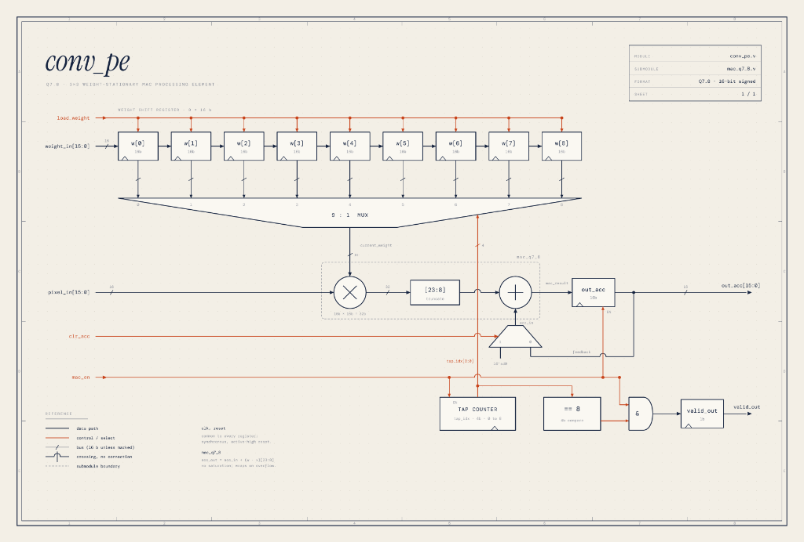
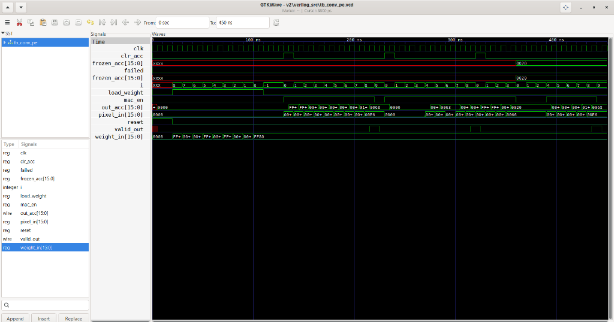
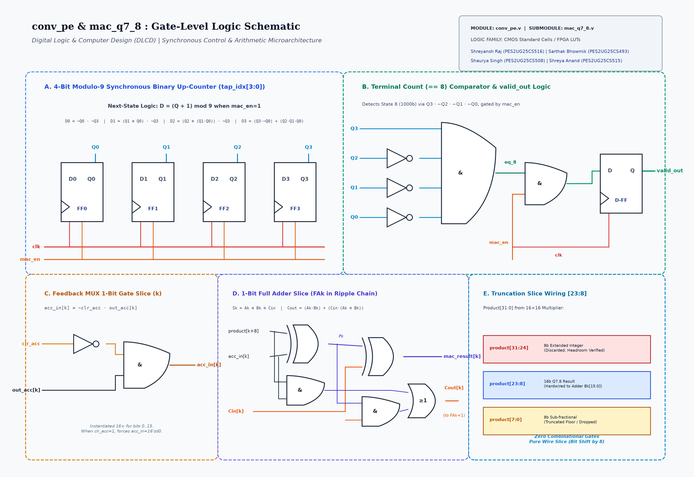

# Mini Project Submission: Digital Circuit Design Specification & Datapath Schematic

**Course:** Digital Logic & Computer Design (DLCD)  
**Project Title:** Hardware Neural Network Accelerator (DLCD Neural Accelerator)  
**Selected Module:** Convolutional Processing Element (`conv_pe.v`) with Sequential Q7.8 MAC Unit (`mac_q7_8.v`)  
**Design Team & SRN:**  
- **Shreyansh Raj** — `PES2UG25CS516`  
- **Sarthak Bhowmik** — `PES2UG25CS493`  
- **Shaurya Singh** — `PES2UG25CS508`  
- **Shreya Anand** — `PES2UG25CS515`  
**Date:** October 2026  

---

## 1. Executive Summary & Module Purpose

In the custom digital neural network accelerator, the **Convolutional Processing Element (`conv_pe.v`)** executes the 2D spatial convolution for the frontend convolutional layer (Conv1).

A fully unrolled 2D convolution requires 9 parallel hardware multipliers per output channel, which demands substantial FPGA DSP and logic resources. To minimize area and routing complexity, this design implements a **9-tap time-multiplexed, weight-stationary sequential Multiply-Accumulate (MAC) processing element**.

### Key Architectural Characteristics:
- **Arithmetic Precision:** Signed Q7.8 Fixed-Point (16-bit signed two's complement: 1 sign bit, 7 integer bits, 8 fractional bits; scale factor $S = 2^8 = 256$, dynamic range $[-128.0, +127.996]$).
- **Dataflow:** Weight-Stationary. The 9 filter weights for the $3 \times 3$ kernel are shifted into internal registers during configuration and held stationary while incoming streaming pixels are evaluated sequentially.
- **Cycle Budget & Throughput:** Exactly 9 clock cycles per $3 \times 3$ receptive field window; produces 1 valid output feature every 9 cycles with continuous streaming support.
- **Hardware Component Footprint (`conv_pe`):**
  - 1 Signed $16 \times 16$ Multiplier (in `mac_q7_8.v`)
  - 1 Signed 16-bit Adder (in `mac_q7_8.v`)
  - 9 16-bit Weight Registers (`weights[0:8]`, arranged as a serial shift register; intentionally unreset)
  - 1 16-bit Accumulator Register (`out_acc`)
  - 1 16-bit 2-to-1 Feedback Multiplexer (`clr_acc` selector)
  - 1 16-bit 9-to-1 Weight Multiplexer (addressed by `tap_idx`)
  - 1 4-bit Synchronous Modulo-9 Binary Up-Counter (`tap_idx`, counts $0$ to $8$, gated by `mac_en`)
  - 1 4-bit Comparator (`tap_idx == 8`) with AND gating for `mac_en`
  - 1 1-bit Output Valid Flip-Flop (`valid_out`)
  *(Note: The full Conv1 array in `conv1_array.v` instantiates 4 of these `conv_pe` instances in parallel, one for each output feature channel).*

---

## 2. Port Interface & Signal Contract

### Table 1: Port List of `conv_pe.v`

| Signal Name | Direction | Bit Width | Type | Active Level | Functional Description |
|---|---|---|---|---|---|
| `clk` | Input | 1 | Clock | Rising Edge | Primary system clock (synchronous domain). |
| `reset` | Input | 1 | Control | High (1) | Synchronous reset. Resets `tap_idx` to 0, `out_acc` to 0, and `valid_out` to 0. *(Weight registers are intentionally not reset to conserve routing resources).* |
| `load_weight` | Input | 1 | Control | High (1) | Active-high shift enable for serial weight loading. Shift order requires reverse sequence ($W_8$ first down to $W_0$ last) so that $W_0$ resides in `weights[0]`. |
| `weight_in` | Input | [15:0] | Data (Q7.8) | — | Serial 16-bit signed weight stream fed during offline configuration. |
| `mac_en` | Input | 1 | Control | High (1) | Clock-enable for MAC computation and tap counter advance. When deasserted, `tap_idx` and `out_acc` freeze their states, and `valid_out` is held low. |
| `clr_acc` | Input | 1 | Control | High (1) | Asserted during Tap 0 to clear accumulator feedback to `16'sd0` for starting a new convolution window. |
| `pixel_in` | Input | [15:0] | Data (Q7.8) | — | 16-bit signed streaming pixel value from sliding-window line buffers. |
| `out_acc` | Output | [15:0] | Data (Q7.8) | — | 16-bit signed accumulated convolution sum. Valid when `valid_out` is asserted. |
| `valid_out` | Output | 1 | Status | High (1) | 1-cycle active-high pulse registered on the clock cycle following Tap 8, indicating that the completed 9-tap sum is valid on `out_acc`. |

---

## 3. Register Transfer Level (RTL) Datapath Schematic

The architectural schematic of the `conv_pe` module is illustrated below:


*Figure 1: Complete Register-Transfer Level (RTL) Datapath Schematic of the Convolutional Processing Element (`conv_pe.v`) with Q7.8 MAC Core (`mac_q7_8.v`), Modulo-9 Tap Counter, and Valid Logic.*

### Datapath Breakdown:
1. **Weight Storage & Selection:** The 9 kernel coefficients ($W_0$ to $W_8$) reside in a $9 \times 16$-bit shift register. A 9-to-1 multiplexer driven by `tap_idx[3:0]` routes `weights[tap_idx]` to the multiplier.
2. **Signed Multiplier (`mac_q7_8`):** Multiplies selected 16-bit signed weight and streaming 16-bit signed `pixel_in`, producing a 32-bit signed product in **Q15.16** format.
3. **Truncation Slice:** Combinational extraction of `product[23:8]`. Bits `[31:24]` are dropped based on verified headroom, and bits `[7:0]` are truncated (floor), aligning the result back to Q7.8 format at zero logic gate cost.
4. **Accumulator Feedback & MUX:** A 2-to-1 multiplexer selects `16'sd0` (when `clr_acc = 1` during Tap 0) or `out_acc` (when `clr_acc = 0`). The 16-bit signed adder sums the truncated product with this accumulator base.
5. **Output Registers & Control Logic:** When `mac_en = 1`, `out_acc` registers the adder sum on each clock edge. On `tap_idx == 8`, `valid_out` registers high for the subsequent clock cycle and `tap_idx` rolls over to 0.

---

## 4. Control Unit & Modulo-9 Tap Counter

The module avoids complex FSM control overhead by employing a synchronous 4-bit modulo-9 binary up-counter (`tap_idx`, counting 0 to 8) enabled by `mac_en`. When `mac_en = 0`, the counter freezes in place; it does not jump to an idle state. Weight loading is orthogonal via `load_weight`.

### Modulo-9 Binary Counter Sequence:
```
[ tap_idx = 0 ] --> [ tap_idx = 1 ] --> [ tap_idx = 2 ] --> ... --> [ tap_idx = 8 ]
      ^                                                                     |
      +------------------------ (wraps to 0) -------------------------------+
```

### Signal Sequence Across a 9-Tap Window:

| Cycle Phase | `mac_en` | `clr_acc` | `tap_idx` | Feedback MUX (`acc_in`) | Multiplier Operation ($P_i$) | `valid_out` |
|---|---|---|---|---|---|---|
| **Tap 0** | 1 | 1 | 0 | `16'sd0` | $P_0 = \text{pixel}_0 \times W_0$ | 0 |
| **Tap 1** | 1 | 0 | 1 | `out_acc` ($P_0$) | $P_1 = \text{pixel}_1 \times W_1$ | 0 |
| **Tap 2** | 1 | 0 | 2 | `out_acc` ($P_0 + P_1$) | $P_2 = \text{pixel}_2 \times W_2$ | 0 |
| **Tap 3..7** | 1 | 0 | 3..7 | `out_acc` ($\sum_{k=0}^{i-1} P_k$) | $P_i = \text{pixel}_i \times W_i$ | 0 |
| **Tap 8** | 1 | 0 | 8 | `out_acc` ($\sum_{k=0}^{7} P_k$) | $P_8 = \text{pixel}_8 \times W_8$ | 0 |
| **Handoff (Next Tap 0)** | 1 | 1 | 0 | `16'sd0` | $P_0' = \text{pixel}_0' \times W_0$ | **1** (Asserted for completed window) |

---

## 5. Q7.8 Fixed-Point Mathematical Formulation & Headroom Analysis

Fixed-point arithmetic maps real values to signed integers using a uniform scaling factor $S = 2^B$, where $B = 8$:
$$X_{\text{fixed}} = \text{round}(X_{\text{real}} \times 2^8)$$

### Multiplication & Bit Format:
Multiplying two 16-bit signed Q7.8 numbers (each having 1 sign bit, 7 integer bits, 8 fractional bits) produces a 32-bit signed product in **Q15.16** format:
$$\text{Product} = A \times B \quad \implies \quad 1\text{ sign bit} + 15\text{ integer bits} + 16\text{ fractional bits} = 32\text{ bits (Scale } 2^{16}\text{)}$$

To rescale to 16-bit Q7.8 format, the product is scaled by $2^{-8}$ via bit-slicing:
$$\text{Product}_{\text{Q7.8}} = \lfloor (A \times B) / 2^8 \rfloor = \text{Product}[23:8]$$

### Bit-Level Breakdown of `product[31:0]`:
```
Product [31:0]:
  [31:24] (8 bits) : Extended integer bits (discarded; headroom verified to avoid overflow)
  [23:16] (8 bits) : Q7.8 Integer part (1 sign bit + 7 integer bits)
  [15:8]  (8 bits) : Q7.8 Fractional part
  [7:0]   (8 bits) : Lower sub-fractional bits (truncated floor; dropped)
```

Extracting `product[23:8]` performs an exact arithmetic right-shift of 8 bits at zero combinational logic cost (pure wiring slice).

### Headroom & Overflow Behavior:
The RTL adder and accumulator implement standard two's complement 16-bit arithmetic without saturation logic; if a value exceeds $[-128.0, +127.996]$, it wraps around. 

In the accelerator training pipeline, inputs are normalized with standard MNIST mean/std ($\mu = 0.1307, \sigma = 0.3081$), producing pixel input values ranging from roughly $-0.424$ to $+2.821$. To rigorously verify that intermediate accumulations never overflow the 16-bit accumulator, the full test set was measured using the bit-exact integer emulator (`int_emulator_v2.py`):
- **Conv1 Accumulator Raw Range:** $[-1253, +2080]$ integer counts.
- **Conv1 Accumulator Real Range:** $[-4.895, +8.125]$ in Q7.8 format.
- **Peak Dynamic Range Utilization:** Peak magnitude is $8.125$, consuming only **$6.3\%$** of the available $[-128.0, +127.996]$ dynamic range.
- **Headroom Margin:** $128.0 - 8.125 = 119.875$ ($> 14\times$ safety margin), providing complete assurance against accumulator overflow.

---

## 6. Cycle-Accurate Timing Diagram & Simulation Waveform

The execution timing across two consecutive 9-tap convolution windows with seamless streaming is detailed below:

### ASCII Timing Diagram:
```
Clock Cycle :    0       1       2       3    ...    7       8       9      10      11
clk         :  _/ \_   _/ \_   _/ \_   _/ \_  ...  _/ \_   _/ \_   _/ \_   _/ \_   _/ \_
mac_en      :  ______/==============================================================
clr_acc     :  ______/=======\_____________________________/=======\________________
pixel_in    :  ------<  p0  ><  p1  ><  p2  > ... <  p7  ><  p8  ><  q0  ><  q1  >----
tap_idx     :  ------<   0  ><   1  ><   2  > ... <   7  ><   8  ><   0  ><   1  >----
weights[idx]:  ------<  w0  ><  w1  ><  w2  > ... <  w7  ><  w8  ><  w0  ><  w1  >----
mac_result  :  ------< Acc0 >< Acc1 >< Acc2 > ... < Acc7 >< Acc8 >< New0 >< New1 >----
out_acc     :  --------------< Acc0 >< Acc1 > ... ... ... < Acc7 >< Acc8 >< New0 >----
valid_out   :  ____________________________________________/=======\________________
                                                               ^
                                                     Window 1 Output Valid!
```

### GTKWave Logic Simulation Waveform:
Below is the actual logic simulation trace captured from `v2/verilog_src/tb_conv_pe.vcd`:


*Figure 2: GTKWave Logic Simulation Trace of `tb_conv_pe.v` verifying Window 1 interior accumulation (`out_acc=104, valid_out=1`), Window 2 zero-padded edge accumulation (`out_acc=19, valid_out=1`), and `mac_en` clock-enable gating.*

---

## 7. Gate-Level Microarchitecture Schematic

Below is the gate-level schematic illustrating the internal logic gates for the control sequencer, comparator, and datapath arithmetic slices:


*Figure 3: Gate-Level Logic Schematic illustrating (A) 4-bit Modulo-9 Synchronous Binary Up-Counter and Next-State Logic, (B) Terminal Count (`== 8`) Comparator and `valid_out` Register, (C) 1-Bit Clear Multiplexer Slice, (D) 1-Bit Full Adder Carry-Chain Slice, and (E) Truncation Wiring Slice.*

### Gate-Level Circuit Details:
1. **Modulo-9 Counter Logic:** Implemented using 4 D flip-flops with next-state combinational gates:
   - $D_0 = \overline{Q_0} \cdot \overline{Q_3}$
   - $D_1 = (Q_1 \oplus Q_0) \cdot \overline{Q_3}$
   - $D_2 = (Q_2 \oplus (Q_1 \cdot Q_0)) \cdot \overline{Q_3}$
   - $D_3 = (Q_3 \cdot \overline{Q_0}) + (Q_2 \cdot Q_1 \cdot Q_0)$
2. **Terminal Count (`== 8`) Comparator:** Detects state $8$ ($1000_2$) via a 4-input AND gate: $\text{eq\_8} = Q_3 \cdot \overline{Q_2} \cdot \overline{Q_1} \cdot \overline{Q_0}$.
3. **Valid Output Gate:** A 2-input AND gate computes $D_{\text{valid}} = \text{eq\_8} \cdot \text{mac\_en}$, clocking into the `valid_out` flip-flop on posedge `clk`.
4. **1-Bit Clear MUX Gate:** Implemented as $Y_k = \overline{\text{clr\_acc}} \cdot \text{out\_acc}_k$ (an inverter and AND gate), forcing `acc_in` to $0$ on Tap 0.
5. **1-Bit Full Adder Slice:** Standard dual-XOR sum generation ($S_k = A_k \oplus B_k \oplus C_{in}$) and carry generation ($C_{out} = A_k \cdot B_k + C_{in} \cdot (A_k \oplus B_k)$).

---

## 8. Verilog Code Implementation (`conv_pe.v` & `mac_q7_8.v`)

### Core MAC Module (`mac_q7_8.v`):
```verilog
module mac_q7_8 (
    input  wire signed [15:0] weight,
    input  wire signed [15:0] in_val,
    input  wire signed [15:0] acc_in,
    output reg  signed [15:0] acc_out
);
    wire signed [31:0] product;

    assign product = weight * in_val;
    always @(*) begin
        acc_out = acc_in + product[23:8];
    end
endmodule
```

### Processing Element Module (`conv_pe.v`):
```verilog
module conv_pe (
    input  wire clk,
    input  wire reset,
    
    // Weight loading interface
    input  wire load_weight,       // Shift enable for weights
    input  wire signed [15:0] weight_in,
    
    // Pixel input interface
    input  wire mac_en,            // Enable MAC operation
    input  wire clr_acc,           // When mac_en is high, ignores previous accumulator value
    input  wire signed [15:0] pixel_in,
    
    // Output
    output reg  signed [15:0] out_acc,
    output reg  valid_out          // Asserted high on the cycle the 9th tap finishes
);
    // 9 weight registers for a 3x3 kernel (Weight-Stationary)
    reg signed [15:0] weights [0:8];
    reg [3:0] tap_idx; // 0 to 8 counter
    
    wire signed [15:0] mac_result;
    wire signed [15:0] current_weight = weights[tap_idx];
    wire signed [15:0] acc_in = clr_acc ? 16'sd0 : out_acc;
    
    // Instantiation of verified Q7.8 MAC
    mac_q7_8 mac_inst (
        .in_val(pixel_in),
        .weight(current_weight),
        .acc_in(acc_in),
        .acc_out(mac_result)
    );

    always @(posedge clk) begin
        if (reset) begin
            tap_idx   <= 0;
            out_acc   <= 0;
            valid_out <= 0;
            // Note: weights are intentionally not reset to save routing resources
        end else begin
            if (load_weight) begin
                // Shift register for weight loading
                weights[8] <= weights[7];
                weights[7] <= weights[6];
                weights[6] <= weights[5];
                weights[5] <= weights[4];
                weights[4] <= weights[3];
                weights[3] <= weights[2];
                weights[2] <= weights[1];
                weights[1] <= weights[0];
                weights[0] <= weight_in;
            end
            
            if (mac_en) begin
                out_acc <= mac_result;
                
                if (tap_idx == 8) begin
                    tap_idx   <= 0;
                    valid_out <= 1;
                end else begin
                    tap_idx   <= tap_idx + 1;
                    valid_out <= 0;
                end
            end else begin
                valid_out <= 0;
            end
        end
    end
endmodule
```

---

## 9. Verification Results & FPGA Resource Analysis

### 1. Directed Testbench Verification (`tb_conv_pe.v`):
The module was verified using the enhanced self-checking testbench `v2/verilog_src/tb_conv_pe.v` compiled with Icarus Verilog:
- **Test Case 1 (Interior $3 \times 3$ Window):** Evaluated 9 non-zero pixel inputs ($P_1 = [0.10, 0.20, \dots, 0.90]$) against signed kernel weights. Expected Q7.8 golden result: `104` ($0.40625$). RTL simulation produced `104` and asserted `valid_out = 1` precisely on cycle 9 (`PASS`).
- **Test Case 2 (Edge $3 \times 3$ Window with Zero-Padding):** Evaluated boundary pixels with zero-padded corner and border positions ($P_2 = [0, 0, 0, 0, 0.50, 0.60, 0, 0.80, 0.90]$). Expected Q7.8 golden result: `19` ($0.0742$). RTL simulation produced `19` and asserted `valid_out = 1` (`PASS`).
- **Test Case 3 (Mid-Stream `mac_en` Stall & Freeze Test):** Deasserted `mac_en` for 3 clock cycles mid-stream at tap 4. Verified that `tap_idx` froze at 4, `out_acc` preserved its intermediate sum without corruption, and `valid_out` remained 0, before seamlessly resuming to finish with `out_acc = 104` (`PASS`).
- **Summary:** Zero mismatches detected across all functional tests (`ALL TESTS PASSED.`).

### 2. Critical Path & FPGA Resource Mapping (Estimated Design Analysis, Unsynthesized):
- **FPGA Mapping Analysis:** Because the `[23:8]` truncation wiring slice sits between the multiplication and addition, the 16-bit adder cannot fold into a single DSP internal feedback accumulator. Consequently:
  - The $16 \times 16$ signed multiplier maps to a dedicated DSP slice (e.g. Xilinx DSP48E1).
  - The `[23:8]` bit-slicing and 16-bit signed adder map to the FPGA fabric logic using dedicated LUT carry chains (`CARRY4`).
- **Timing Estimate:** In a typical FPGA fabric (such as Xilinx Artix-7), the DSP multiplication combined with LUT carry-chain addition easily operates within a single clock cycle at estimated frequencies of 100 to 150 MHz without requiring multi-stage pipeline registers.

### 3. Hardware Resource Trade-Off Arithmetic:
Compared to a fully unrolled parallel 2D convolution engine that instantiates 9 multipliers per channel:
$$\text{Multiplier Reduction Ratio} = \frac{9 - 1}{9} = \frac{8}{9} \approx 88.89\%$$

By time-multiplexing a single hardware multiplier across 9 clock cycles, the design reduces multiplier resource requirements by $88.89\%$ per convolutional channel while maintaining deterministic 9-cycle throughput for real-time inference.
